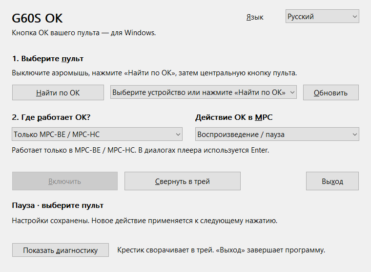
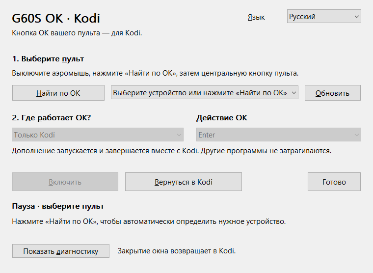

# Remote OK

[English](README.en.md)

Кнопка **OK** пульта G60S Pro для Windows: отдельная программа и дополнение Kodi с общей логикой обработки HID. AutoHotkey, дополнительные драйверы и установка Visual C++ Runtime не требуются.

Название проекта не привязано к одному пульту. Первый поддерживаемый пульт — **G60S Pro**; другие модели пока не заявлены. Текущие программа и дополнение сохраняют имя G60S OK.

**Версия 1.1.0 находится на локальной проверке.** Архивы с суффиксом `-local` — тестовые сборки. Физический пульт с новой версией ещё нужно проверить; пользователь подтвердил работу предыдущего прототипа. Публичные релизные EXE и ZIP будут собираться только в GitHub Actions из тега версии.

## Что выбрать

| Пакет | Назначение |
| --- | --- |
| `G60S-OK-Windows-x64-1.1.0[-local].zip` | OK как Enter в программах Windows; отдельный режим MPC-BE / MPC-HC |
| `script.g60s.ok-1.1.0[-local].zip` | OK как Enter только в активном Kodi; обработчик запускается и завершается вместе с Kodi |

Нужны Windows 10/11 x64 и локальный рабочий стол. Дополнение рассчитано на Kodi 21/22 для Windows x64. Проверенные версии и границы проверки перечислены в [отчёте](docs/testing.md).

## Отдельная программа

1. Завершите прежнюю утилиту 1.0 и старые AutoHotkey-скрипты, переназначающие ту же кнопку. Распакуйте ZIP и запустите `G60S-OK.exe`.
2. Подключите USB-приёмник или Bluetooth-пульт. Выключите режим аэромыши на пульте.
3. Нажмите **Найти по OK**, затем OK на пульте. Отпустите кнопку. Поиск выбирает устройство, но не включает переназначение.
4. Выберите **Все программы** или **Только MPC-BE / MPC-HC**. Для MPC можно выбрать Enter, воспроизведение/паузу или переключение полного экрана. В диалогах плеера остаётся Enter.
5. Нажмите **Включить**, перейдите в нужную программу и проверьте OK. Удержание не создаёт повторов; отдельные действия удержания и двойного нажатия не реализованы.

В режиме «Все программы» выбранное действие MPC действует в главном окне плеера, в остальных программах отправляется Enter. Режим «Только MPC» игнорирует остальные программы. Имена исполняемых файлов плееров должны быть стандартными: `mpc-hc.exe`, `mpc-hc64.exe`, `mpc-be.exe` или `mpc-be64.exe`.

Крестик и **Свернуть в трей** оставляют программу работающей. Двойной щелчок по значку в трее открывает настройки; **Выход** завершает программу. Автозапуск Windows не добавляется. Для запуска сразу в трее можно создать ярлык с аргументом `--tray`.

## Дополнение Kodi

1. В Kodi откройте **Дополнения → Установить из ZIP-файла** и выберите архив `script.g60s.ok-…zip`. Если Kodi попросит, разрешите установку из неизвестных источников. Сам архив распаковывать не нужно.
2. Откройте **Программные дополнения → G60S OK for Kodi**. Появится отдельное окно настройки Windows.
3. Выключите аэромышь, нажмите **Найти по OK**, затем OK на пульте. Отпустите кнопку, нажмите **Включить → Вернуться в Kodi**.

Выбранный пульт и состояние сохраняются. При следующем запуске Kodi обработчик запускается сам. Дополнение действует только в окнах своего процесса Kodi. Закрытие настройки возвращает в Kodi; отключение или удаление дополнения останавливает обработчик. Отдельно запускать вложенный EXE не требуется.

Обе поставки **1.1** могут работать одновременно: при активном Kodi приоритет имеет его дополнение, даже если в нём нажата «Пауза». После отключения дополнения общий режим отдельной программы снова может действовать в Kodi. Версии 1.0 не поддерживают совместную работу — завершите их перед переходом на 1.1.

## Язык и настройки

Список **Язык** переключает интерфейс сразу: автоматически, English или Русский. Автоматический выбор использует язык Windows, а в дополнении — язык Kodi при запуске обработчика. Выбранный вручную язык сохраняется.

Настройки отдельной программы находятся в `%LOCALAPPDATA%\G60S-OK\settings.ini`, дополнения — в `addon_data/script.g60s.ok/remote.ini` активного профиля Kodi. При отключении пульта программа ждёт его возвращения и восстанавливает включённое состояние только для того же пути устройства. После переподключения в другой USB-порт или повторного Bluetooth-сопряжения может потребоваться новый поиск.

## Если OK не работает

- Проверьте режим аэромыши и нажмите **Обновить**, затем **Найти по OK**. Поиск можно отменить; он также заканчивается через 30 секунд.
- Убедитесь, что выбран пульт, нажато **Включить**, нужная программа активна и подходит выбранному режиму.
- Завершите старые копии G60S OK и другие переназначатели этой кнопки. Программа добавляет Enter, но не блокирует исходное HID-событие: приложение, которое уже само обрабатывает Menu Pick, может выполнить действие дважды. В таком приложении приостановите переназначение или используйте режим только MPC.
- Windows может блокировать отправку ввода в программу с более высоким уровнем прав. Обычно обе программы следует запускать без повышения прав.
- **Показать диагностику** открывает журнал Consumer HID в памяти. Он не перехватывает набираемый текст, не отправляет данные и не сохраняет журнал на диск. Копирование выполняется только кнопкой **Копировать диагностику**. Перед публикацией скопированного журнала проверьте названия устройств и их идентификаторы.

Поддерживаются HID Consumer Menu Pick (`0x0C / 0x41`) и известные трёхбайтовые отчёты G60S. Другая прошивка или вариант пульта может передавать иные данные. Bluetooth и физическое переподключение новой версии пока не проверены. Это не прошивка пульта и не драйвер; остальные кнопки не переназначаются.

## Разработка

См. [сборку](docs/build.md), [архитектуру](docs/architecture.md), [проверки](docs/testing.md), [обзор интерфейса](docs/ui-review.md) и [roadmap](roadmap.md). Лицензия — [MIT](LICENSE); [источники технической информации](docs/credits.md).
