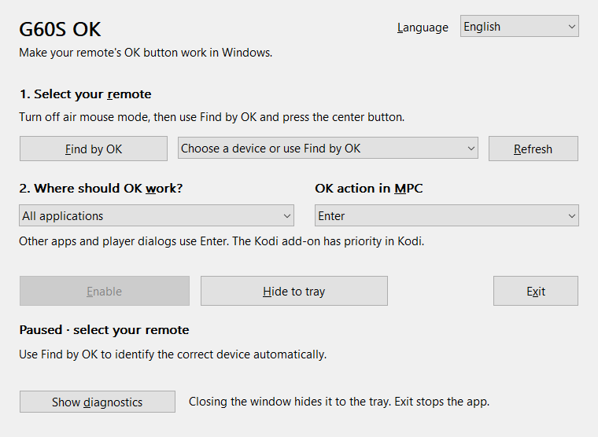
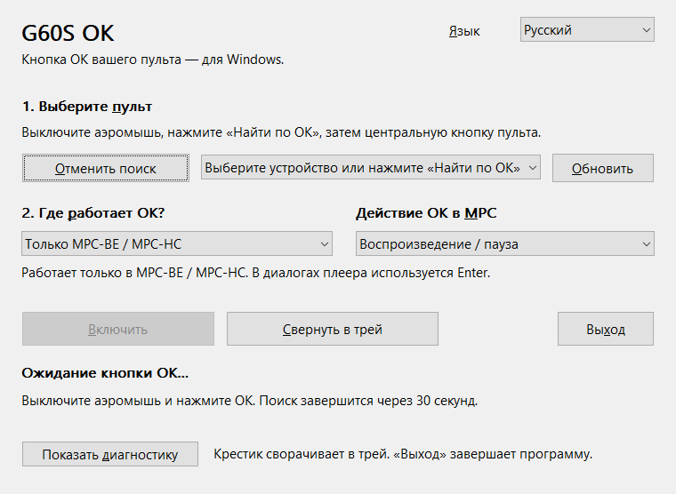
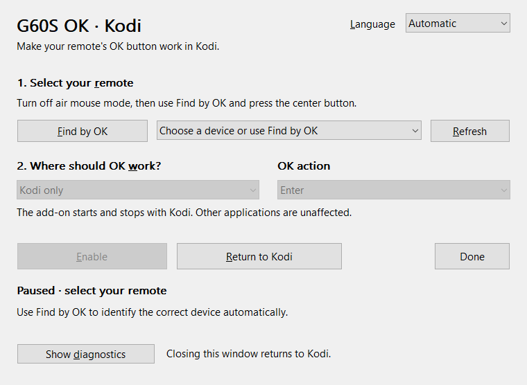
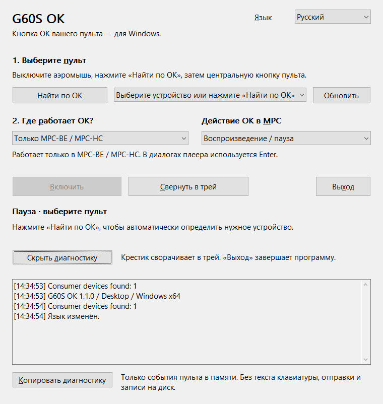
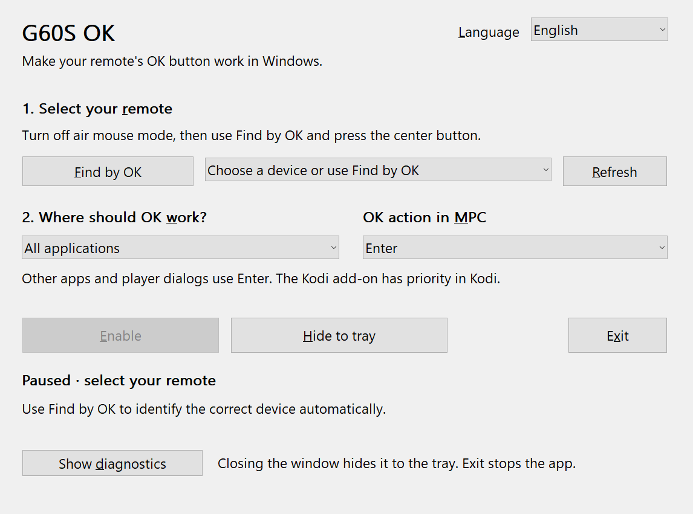
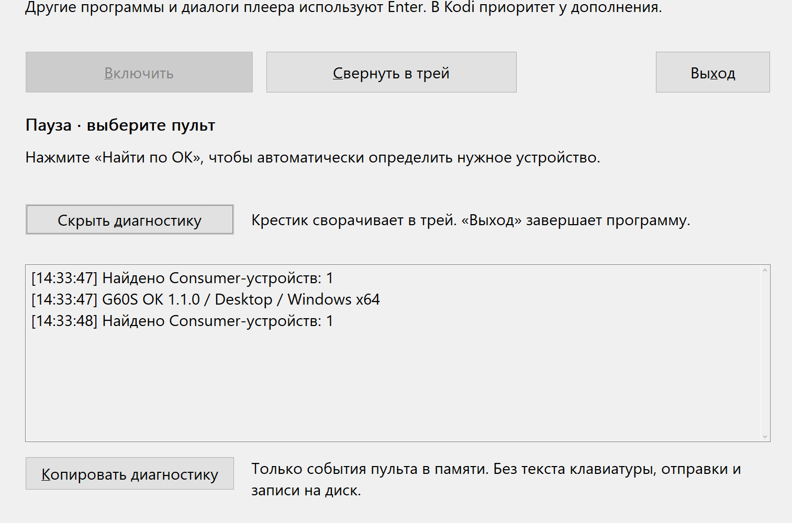

# Проверка интерфейса / UI review

Fresh captures from the native 1.1.0 windows were inspected on 2026-10-14. The main flow fits in a 760 × 556 logical-pixel client area; diagnostics expand on request. No physical remote was connected for discovery or enabled-state testing.

## 1. Выбор языка и начало настройки — проверено

English and Russian labels fit at the tested scale. The window explains what OK will do and names the first action. A missing selection keeps **Enable** disabled and displays the next step in text. Language changes apply immediately and survive restart.

## 2. Поиск пульта — интерфейс проверен; физический сигнал ожидает проверки

Discovery replaces the button with a cancel action, pauses mapping and explains the air-mouse setting and 30-second timeout. Cancelling returns to the paused state. The physical “remote found” transition and the real enabled state still need a G60S remote.

## 3. Режим работы и возврат в приложение — проверено

The desktop's scope and MPC action are separate controls. The MPC-only hint explicitly says other applications are ignored. Kodi's fixed scope/action are disabled, and **Return to Kodi** describes the next action. Closing the window keeps the service running. Tray/exit behavior is explained in the footer for the desktop app.

## 4. Диагностика и крупный масштаб — проверено в указанном объёме

The log is initially collapsed, can be expanded and copied explicitly, and has a privacy explanation beside it. At simulated 144/192 DPI the layout remains legible and controls fit horizontally; vertical scrolling exposes the lower content and copy button. A stale repaint artifact found during this check was fixed and recaptured. The simulation used the real native UI through a test-only entry; Windows monitor scaling was not changed.

## Ограничения / Limits

The UI uses standard native controls, text labels, keyboard mnemonics and visible focus outlines. Its status does not rely on color alone. Screenshots do not establish screen-reader support or full accessibility conformance. Narrator, high-contrast themes, real multi-monitor DPI transitions, very narrow screens and a TV viewed from a distance were not tested. The compact window is intended for initial setup using a mouse/keyboard; no remote-only setup flow is claimed.

The reviewed screenshots show the actual windows without device paths. Earlier notification/hint mistakes were corrected: the empty selection no longer says a device was selected, and the MPC-only mode no longer describes input in other applications.
